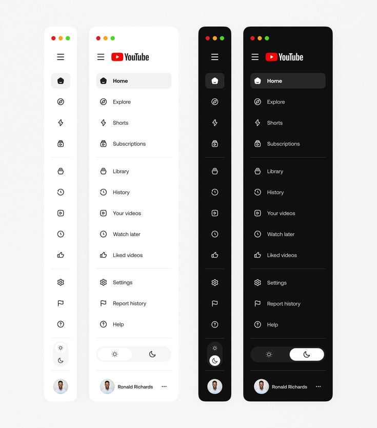

# YouTube Sidebar

A static YouTube-style navigation sidebar with light and dark themes, built with HTML, CSS, and JavaScript.



## Features

- Full-height sidebar docked on the left
- Collapsible menu — icons only, with hover tooltips
- Light / dark theme with preference saved in `localStorage`
- Account menu (three-dot dropdown)
- Main area watermark

## Getting started

No build step or install. Open the page in a browser:

```bash
# from the project folder
xdg-open index.html
```

Or serve the folder with any static server if you prefer.

## Project structure

```
small-pro/
├── index.html
├── assets/
│   └── preview.jpg
├── css/
│   └── styles.css
└── js/
    ├── theme-init.js   # applies saved theme before first paint
    └── main.js
```

## Author

**Emranullah Rasoli** · @emranullahrasoli